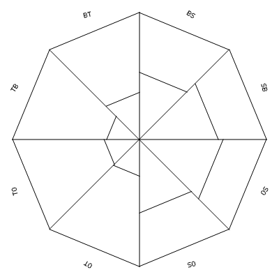

# LearyCircumplex

[](https://github.com/richelbilderbeek/LearyCircumplex/actions/workflows/build_tool.yaml)
[](https://github.com/richelbilderbeek/LearyCircumplex/actions/workflows/create_zensical_website.yaml)

LearyCircumplex is a tool to generate an image of a Leary
circumplex (also called 'Interpersonal circumplex' or 'Leary circle'
or (in Dutch) 'Roos van Leary') after having scored the results of
a questionnaire.



- [Website](https://richelbilderbeek.github.io/LearyCircumplex/):
  use the tool in your web browser, see examples, download the Windows version
- Video of version 1.0: [YouTube](https://youtu.be/S15O6htUkjw)

## Build

The tool uses C++ and the Qt (5 or 6) libraries:

```bash
cd code
qmake LearyCircumplex.pro
make
./LearyCircumplex
```

Version 1.0 used C++ Builder and its VCL library.

## Website

The website is built with [Zensical](https://zensical.org) from the `docs` folder.
To view it locally:

```bash
pip install zensical
zensical serve
```

## Links

- [Wikipedia's page on 'Interpersonal circumplex'](https://en.wikipedia.org/wiki/Interpersonal_circumplex)
