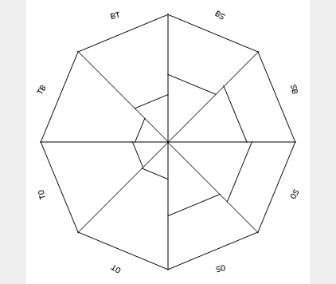
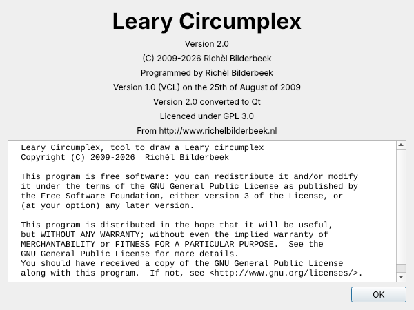

# Download

## Windows

[Download the Windows version](learycircumplex_windows.zip):
unzip it and run `LearyCircumplex.exe`.

## Build from source

Leary Circumplex uses C++ and the Qt (5 or 6) libraries.

```bash
git clone https://github.com/richelbilderbeek/LearyCircumplex
cd LearyCircumplex/code
qmake LearyCircumplex.pro
make
./LearyCircumplex
```

## Screenshots





