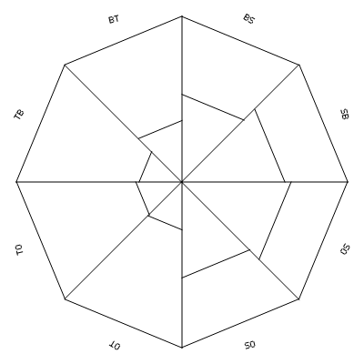
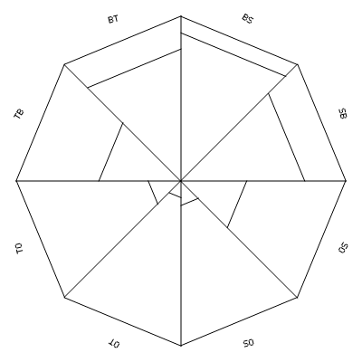
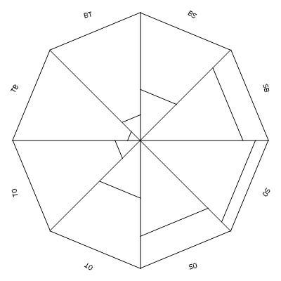
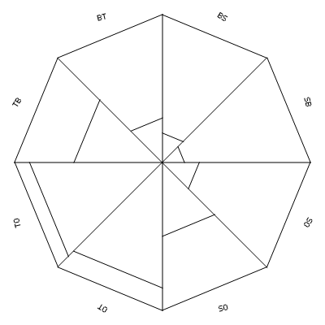
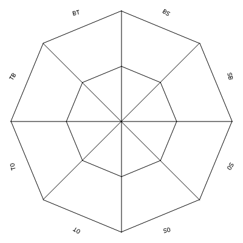

# Examples

## The eight parts

The legend uses the Dutch abbreviations,
with the first letter being the main direction:

Abbreviation|Dutch       |English
------------|------------|---------------------
`BS`        |Boven-Samen |Above-Together: leading
`SB`        |Samen-Boven |Together-Above: helping
`SO`        |Samen-Onder |Together-Below: cooperative
`OS`        |Onder-Samen |Below-Together: dependent
`OT`        |Onder-Tegen |Below-Against: withdrawn
`TO`        |Tegen-Onder |Against-Below: defiant
`TB`        |Tegen-Boven |Against-Above: aggressive
`BT`        |Boven-Tegen |Above-Against: competitive

The legend can be changed to any text.

## Profiles

Each example below shows the scores (in the order of the table above)
and the resulting drawing.

### Default

The scores the tool starts with: 5.3, 6.2, 6.6, 5.8, 2.9, 2.8, 2.6, 3.7.

### Leading

Someone who mostly takes the lead: 9.0, 7.5, 4.0, 1.5, 1.0, 2.0, 5.0, 8.0.

### Cooperative

Someone who mostly works together: 4.0, 8.0, 9.0, 7.5, 4.5, 2.0, 1.0, 2.0.

### Withdrawn

Someone who mostly withdraws: 2.0, 1.5, 2.5, 5.0, 8.5, 9.0, 6.0, 3.0.

### Balanced

All scores are 5.0.

