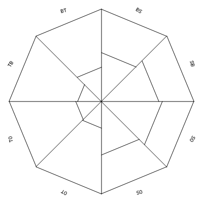
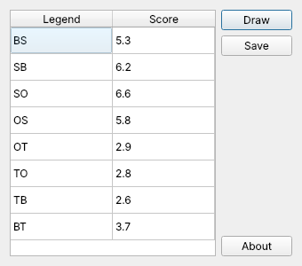

# Leary Circumplex

Leary Circumplex is a tool to draw a Leary circumplex
(also called 'interpersonal circumplex', 'Leary circle'
or, in Dutch, 'Roos van Leary')
from the scores of a questionnaire.

## What it does

1. Type in the eight scores, from 0.0 to 10.0
2. Click 'Draw' to see the Leary circumplex
3. Resize the window to get a bigger or smaller drawing
4. Click 'Save' to save the drawing as an image

You can [use Leary Circumplex in your web browser](use.md),
or [download it](download.md).
See [the examples](examples.md) for what different scores look like.

## What is a Leary circumplex?

A Leary circumplex shows how someone behaves towards others,
along two axes:

- Above versus below: leading or following
- Together versus against: cooperating or opposing

These two axes divide the circle in eight parts,
see [the examples](examples.md).
The further a line is from the center,
the more often the behavior is shown.

## Links

- [Source code](https://github.com/richelbilderbeek/LearyCircumplex)
- [Wikipedia's page on 'Interpersonal circumplex'](https://en.wikipedia.org/wiki/Interpersonal_circumplex)
